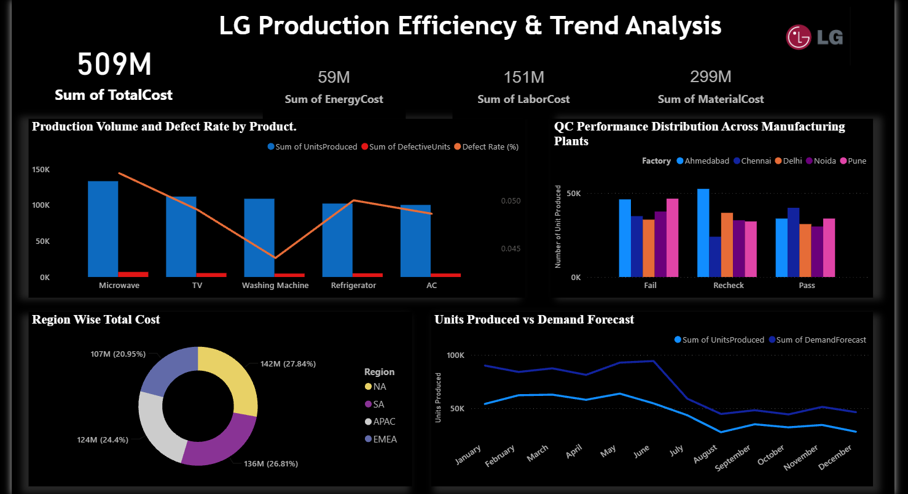

# LG Production Efficiency & Trend Analysis

## 📌 Project Overview

**LG Production Efficiency & Trend Analysis** is a Power BI dashboard that brings together manufacturing cost, production output, product defects, factory quality-control results, regional spending, and monthly demand planning in one view.

The dashboard is designed to help users explore where manufacturing costs are concentrated, compare output and defects across product categories, review QC outcomes across plants, and assess how monthly production tracks against the demand forecast.

## 🎯 Project Objectives

- Monitor overall manufacturing cost and its energy, labor, and material components.
- Compare units produced and defective units across product categories.
- Examine product-level defect rates to identify areas for further quality investigation.
- Compare QC outcomes (Fail, Recheck, and Pass) across manufacturing plants.
- Understand how total manufacturing cost is distributed across regions.
- Compare monthly units produced with the demand forecast from January through December.

## 🛠️ Tools & Technologies

- **Microsoft Power BI Desktop** — Dashboard development and data visualization
- **DAX (Data Analysis Expressions)** — Measures and calculations
- **CSV** — Source dataset

## 📊 Dashboard Overview

### 1. Manufacturing Cost KPIs

The top-level KPI cards summarize total manufacturing cost and its main components.

| KPI | Dashboard value |
|---|---:|
| Total Cost | 509M |
| Energy Cost | 59M |
| Labor Cost | 151M |
| Material Cost | 299M |

The figures are displayed in millions (M) and represent the totals shown in the dashboard.

### 2. Production Volume and Defect Rate by Product

A combined chart compares **Units Produced** and **Defective Units**, with **Defect Rate (%)** shown as a line, across five product categories:

- Microwave
- TV
- Washing Machine
- Refrigerator
- AC

This view supports product-level comparisons of production scale and quality performance.

### 3. QC Performance Distribution Across Manufacturing Plants

A clustered column chart compares the number of units recorded under each QC outcome for five manufacturing plants:

- Ahmedabad
- Chennai
- Delhi
- Noida
- Pune

The QC outcome categories are:

- **Fail**
- **Recheck**
- **Pass**

This breakdown makes it possible to compare quality-control results between plants and outcome categories.

### 4. Region-wise Total Cost

A doughnut chart shows the share of total manufacturing cost across the regions displayed in the report:

- NA
- SA
- APAC
- EMEA

The chart labels show the following values:

| Region | Total Cost | Share |
|---|---:|---:|
| NA | 142M | 27.84% |
| SA | 136M | 26.81% |
| APAC | 124M | 24.40% |
| EMEA | 107M | 20.95% |


### 5. Units Produced vs Demand Forecast

A monthly line chart compares **Units Produced** with **Demand Forecast** from January to December.

It helps highlight months where production is above or below the forecast and supports review of production planning against expected demand. The chart should be interpreted as a comparison of the two monthly series; any operational conclusions should be checked against the underlying data and business context.

## 📈 What You Can Analyze

The dashboard brings together several manufacturing perspectives:

- **Cost structure:** total cost and the contribution of energy, labor, and materials.
- **Product performance:** production volume, defective units, and defect rate by product.
- **Factory quality:** Fail, Recheck, and Pass counts across Ahmedabad, Chennai, Delhi, Noida, and Pune.
- **Regional spending:** total cost and percentage share by region.
- **Production planning:** monthly production compared with demand forecast.

The dashboard provides a basis for exploration. Validate source data, field definitions, and measure calculations before treating visual patterns as confirmed business findings.

## 🧮 DAX Measure

### Defect Rate (%)

The defect-rate measure divides defective units by total units produced and returns zero when the denominator is zero:

```DAX
Defect Rate (%) =
DIVIDE(
    [Total Defective Units],
    [Total Units Produced],
    0
)
```

Format the measure as a percentage in Power BI. Ensure that the component measures use the intended unit counts and filter context.

## 📂 Project Files

- 📊 [**Dataset (CSV)**](https://github.com/SahilKumar-003/LG-Production-Efficiency-Trend-Analysis/blob/main/lg_production_data.csv) — Source data for the manufacturing analysis.
- 📈 [**Dashboard (Power BI PDF)**](https://github.com/SahilKumar-003/LG-Production-Efficiency-Trend-Analysis/blob/main/project_LG%28power_bi%29.pdf) — Exported dashboard report.
- 🖼️ [**Dashboard Screenshot**](https://github.com/SahilKumar-003/LG-Production-Efficiency-Trend-Analysis/blob/main/Lg_production_dashboard.png) — Static dashboard preview.
- 💻 [**Power BI Report (.pbix)**](https://github.com/SahilKumar-003/LG-Production-Efficiency-Trend-Analysis/blob/main/project_LG%28power_bi%29.pbix) — Interactive report for Power BI Desktop.

## 📊 Dashboard Preview



[**Open the dashboard PDF**](https://github.com/SahilKumar-003/LG-Production-Efficiency-Trend-Analysis/blob/main/project_LG%28power_bi%29.pdf)

## 🚀 How to Use

1. Clone or download this repository.
2. Open the dashboard PDF to view the report.
3. Open the `.pbix` file in **Microsoft Power BI Desktop** to explore the interactive dashboard.
4. To rebuild or modify the report, import `lg_production_data.csv` using **Home → Get Data → Text/CSV**.
5. Check column data types, date fields, categorical values, and missing data.
6. Review or create the required DAX measures and visuals.
7. Refresh the report when the source dataset changes, then validate the updated results.

## 👤 Author

**Author:** Sahil Kumar  
**Project:** LG Production Efficiency & Trend Analysis  
**Technology:** Microsoft Power BI
